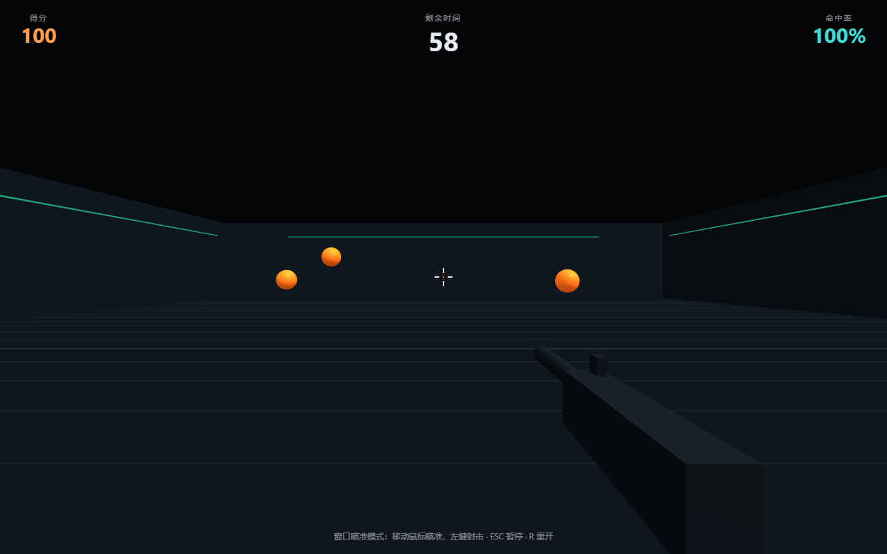

# Aim Trainer 3D · 3D 瞄准练习

基于 Three.js 的网页版 FPS 瞄准训练小游戏。**单文件 · 零构建 · 零安装，打开即玩。**

▶ **在线试玩**：<https://EthanLyu75.github.io/aim-trainer-3d/>



## 训练模式

| 模式 | 说明 | 适合练习 |
|------|------|----------|
| 经典模式 | 3 个固定靶同时存在，命中即刷新 | 基础定位 |
| 甩狙模式 | 单个微型靶，命中即刷新 | 极限反应、甩枪 |
| 移动靶 | 3 个横向匀速移动的靶子 | 跟枪、预判 |

时长可选 30 / 60 / 120 秒，鼠标灵敏度可调。

## 操作

- 点击「开始训练」后鼠标被锁定用于转动视角
- **左键射击 · ESC 暂停 · R 重新开始**
- 若浏览器拒绝锁定指针，会自动切换为「窗口瞄准模式」：准星跟随鼠标移动，点击射击，功能完全一致

## 特性

- 得分、命中率、平均反应时间、最长连击完整统计，结束后有结算面板
- 快速命中（< 0.35s）可获得速度加分
- 最佳成绩按「模式 + 时长」保存在本地（localStorage）
- 后座力、枪口火光、枪械摆动、命中标记、飘分等手感细节
- WebAudio 实时合成音效（枪声 / 命中 / 脱靶），无音频文件
- 整个游戏就是一个 `index.html`，无构建步骤、无外部图片音频资源

## 技术实现

- **渲染**：Three.js r128（WebGL），训练房间 + 网格地板 + 氛围灯带
- **视角**：Pointer Lock API 获取鼠标原始增量，累积为 yaw / pitch 驱动相机旋转
- **命中判定**：CPU 上的射线投射（Raycaster）——准星 2D 坐标反投影为 3D 射线，与靶球求交
- **音效**：WebAudio AudioContext 实时合成
- **降级策略**：指针锁定不可用时（如 iframe 内嵌）自动切换窗口瞄准模式

## 本地运行

无需安装任何依赖，克隆后双击 `index.html` 即可：

```bash
git clone https://github.com/EthanLyu75/aim-trainer-3d.git
```

## 目录结构

```
aim-trainer-3d/
├── index.html          # 全部代码（HTML + CSS + JS 单文件）
├── docs/
│   └── screenshot.png  # 游戏截图
├── LICENSE             # MIT
└── README.md
```

## License

[MIT](LICENSE)
